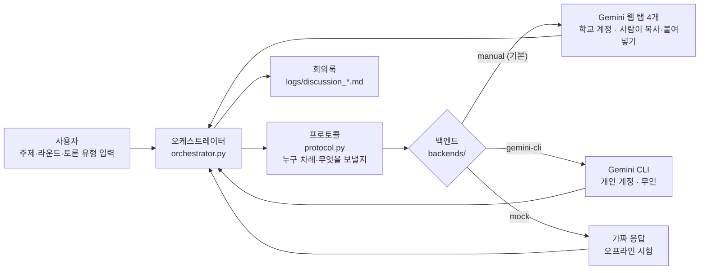
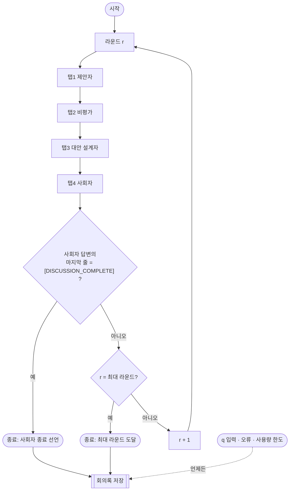
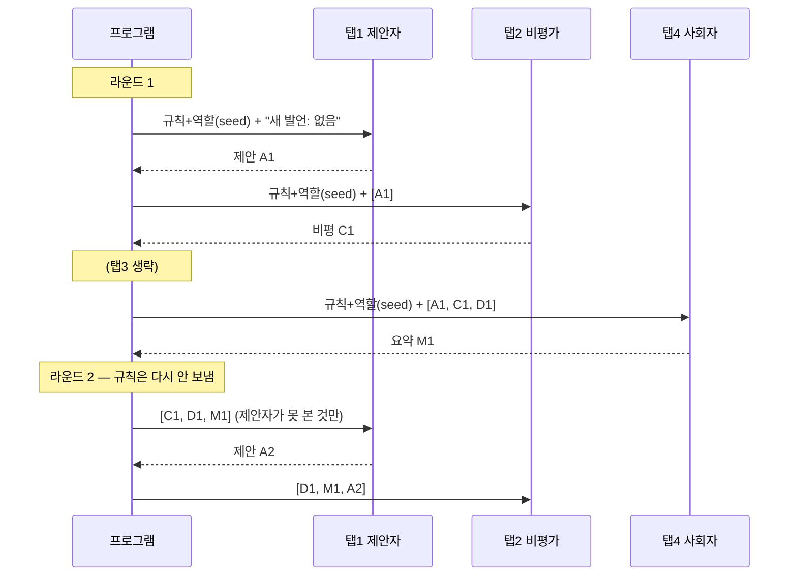
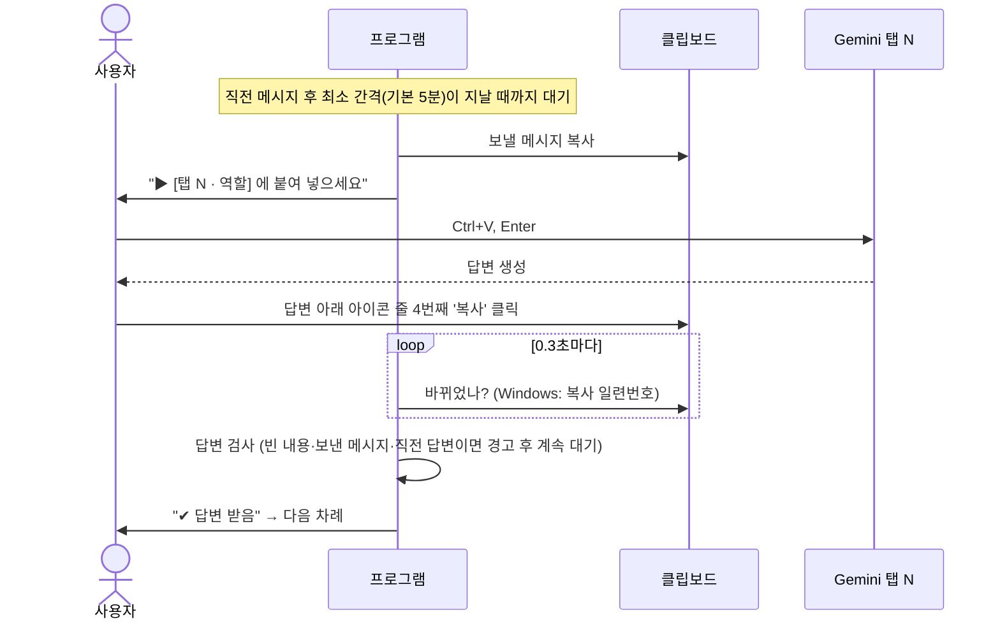
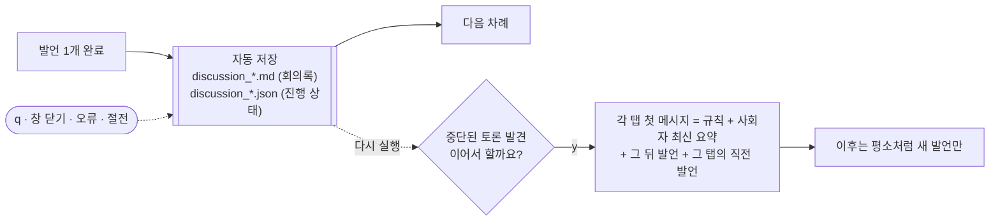

# 프로그램 파이프라인: Gemini 를 어떻게 활용하는가

이 문서는 `gemini_council` 이 Gemini 를 4명의 토론 참가자로 쓰는 방식을 코드 기준으로 설명한다.
(그림은 GitHub 에서 바로 렌더링되는 Mermaid 형식)

## 1. 한눈에 보기

- **Gemini 는 토론의 '두뇌'만 맡는다.** 순서, 무엇을 누구에게 보낼지, 언제 끝낼지, 기록은 모두 프로그램이 한다.
- 같은 Gemini 를 **역할이 다른 4개의 독립 대화**로 나눠 쓴다. 각 대화는 자기 역할의 규칙만 알고 있다.

## 2. 4개의 Gemini 대화 (역할)

| 탭 | 역할 | 권장 모델 | 맡는 일 | 역할 전용 규칙 |
|---:|---|---|---|---|
| 1 | 제안자 | Flash | 초기 설계안 제시, 지적을 반영해 안을 갱신 | — |
| 2 | 비평가 | **Pro (사고 모드)** | 허점·예외·한계 검증 | 매 발언 `치명적 약점:` 1개 의무, 근거 없는 동의 금지, 질문형 마무리 금지 |
| 3 | 대안 설계자 | Flash | 지적을 반영한 현실적 수정안 | — |
| 4 | 사회자 | Flash | 라운드 요약, 남은 쟁점, 종료 판단 | 종료 토큰은 사회자만 앎, 라운드 수와 무관하게 판단 |

**모든 역할 공통 규칙** (`roles.py` 의 `build_seed_prompt`)

1. 인사·칭찬·'전폭 수용' 같은 수사 금지. 받아들이는 점은 무엇을 왜 받아들이는지 한 줄로.
2. 수치는 출처나 계산이 있을 때만, 추정치는 `(추정)` 표시. 출처 없는 수치 금지.
3. 공백 포함 1000자 이내.
4. (사회자 제외) 3단 구조: (1) 입장 (2) 근거 (3) 제안/요구사항.

**토론 유형** — `연구 주제 검토`(`--agenda topic-review`)를 고르면 모든 참가자에게 4개 점검 항목이 주어지고,
사회자는 매 라운드 항목별로 `해결/부분/미해결`을 표시하며 **모두 '해결'일 때만** 종료를 선언한다.

| 점검 항목 | 묻는 것 |
|---|---|
| 새로운 점 | 선행연구 대비 무엇이 새로운가 (확인 안 된 문헌은 '확인 필요') |
| 실현 가능성 | 학위 기간·장비·연산·데이터로 완수 가능한가 |
| 위험 | 기술·안전·일정상 실패 지점과 대비책 |
| 대안 비교 | 범위를 바꾼 대안 주제보다 나은가 |

## 3. 라운드 진행

- **최대 라운드 수는 Gemini 에게 알려주지 않는다.** 화면에는 `[현재] 라운드 2, 비평가의 차례입니다.` 만 보인다.
  첫 실사용에서 `라운드 r/3` 을 보여 줬더니 사회자가 예산에 맞춰 3라운드에 정확히 수렴을 선언했기 때문.
- 종료 토큰은 **사회자 답변의 마지막 줄에 단독으로** 있을 때만 인정한다 (본문 중 인용, 다른 역할의 출력은 무시).
- 어떤 방식으로 끝나든 (정상, 최대 라운드, `q`, 사용량 한도, 오류) 회의록은 항상 저장된다.

## 4. 각 탭에 무엇이 들어가나 (맥락 전달)

웹 탭은 자기 대화를 기억하므로, **처음 한 번만 규칙을 주고 이후엔 '그 탭이 아직 못 본 발언'만** 보낸다.

| | 라운드 1 (첫 메시지) | 라운드 2 이후 |
|---|---|---|
| 보내는 내용 | 규칙·역할·점검 항목 + 앞사람들 발언 | 지난 내 발언 이후 나온 다른 3명의 발언 |
| 길이 (첫 실사용) | 약 500 ~ 3,200자 | 차례당 약 2,500 ~ 3,300자로 **일정** |

전체 대화를 매번 다시 보내면 라운드마다 입력이 계속 커진다(총량 O(N²)). 델타만 보내면 라운드가 늘어도 차례당 입력이 일정하다
(`tests/test_protocol.py::test_prompt_length_bounded` 로 검증).

무인 모드(`gemini-cli`)는 호출마다 기억이 없으므로 대신 **규칙 + 사회자 최신 요약 + 그 뒤 발언**을 보낸다. 사회자 요약이 압축된 기억 역할을 한다.

## 5. 반자동 모드 한 차례의 흐름 (기본 모드)

- 프로그램은 **Gemini 화면을 전혀 조작하지 않는다.** 로컬 클립보드만 읽고 쓴다. 그래서 학교 계정을 자동화 위험 없이 쓸 수 있다.
- **차례 사이 최소 간격** (기본 5분, `--interval` 분 단위): 직전 메시지를 클립보드에 넣은 뒤 이 시간이 지나야 다음 메시지를 내보낸다.
  Gemini 에 메시지가 몰려 나가지 않게 하기 위함 (학교망에서 Google 트래픽 확인 화면이 뜬 뒤 도입). 3라운드면 대기만 약 55분.
- 명령: `r` + Enter = 보낼 메시지 다시 복사, `n` + Enter = 대기 건너뛰기, `q` + Enter = 저장 후 종료.
- 한계: 기다리는 동안 다른 글을 복사하면 그 글이 답변으로 처리된다.

## 6. 탭 재활용과 이어 하기

- **탭 재활용:** 매 실행에서 각 탭의 첫 메시지 앞에 `[새 토론 시작 — 이전 대화 무시]` 를 붙인다.
  지시에 의한 리셋이므로 이전 내용은 Gemini 맥락에 남는다 (완전한 리셋은 새 채팅).
- **자동 저장:** 발언마다 임시 파일에 쓴 뒤 교체(원자적 쓰기)하므로 저장 도중 꺼져도 파일이 깨지지 않는다.
  회의록 파일이 다른 프로그램에 잠겨 있으면 경고만 하고 토론은 계속한다 (다음 발언 때 다시 저장).
- **이어 하기:** 탭이 대화를 잃었다고 가정하고 맥락을 한 번에 다시 넣는다. 같은 회의록 파일에 이어서 기록하고
  머리에 `중단 후 이어 하기: N회` 를 남긴다.

## 7. 산출물: 회의록

`logs/discussion_YYYYMMDD_HHMMSS.md`

- 머리: 주제, 시작·종료 시각, 종료 사유, 진행 라운드, 길이 초과 발언 수, 점검 항목
- 본문: 라운드별 발언 전문 (글자 수, 1000자 초과 시 `⚠ 길이 초과`)
- 끝: 사용량 표 (탭별 보낸·받은 글자 수, 대기 시간), 중단된 경우 '이어서 하려면' 안내

## 8. 결과를 읽을 때 주의

- Gemini 의 수치·문헌은 규칙으로 줄였을 뿐 **사라지지 않는다.** `(추정)`, `확인 필요` 표시와 출처 없는 숫자를 따로 확인할 것.
- 참가자가 서로 동의했다고 해서 맞는 것은 아니다. 회의록은 **결론이 아니라 검증할 질문 목록**으로 쓰는 것을 권장.
- 같은 모델(Gemini)끼리의 토론이라 관점이 비슷해질 수 있다. 비평가에 Pro 를 권장하는 것은 이를 줄이려는 의도이며, 효과는 측정하지 않았다.

## 9. 코드 위치

| 파일 | 역할 |
|---|---|
| `council/roles.py` | 역할 정의, 공통·전용 규칙, 점검 항목(`AGENDAS`), seed 프롬프트 |
| `council/protocol.py` | 차례별 메시지 조립(델타/요약), 종료 토큰 판정 |
| `council/orchestrator.py` | 라운드 루프, 일시정지·중단, 모든 종료 경로에서 저장 |
| `council/backends/manual.py` | 반자동: 클립보드 중계, 오복사 검사 |
| `council/backends/gemini_cli.py` | 무인: Gemini CLI 헤드리스 호출 |
| `council/clipboard.py` | OS 클립보드 (Windows Win32 API 직접) |
| `council/session.py` | 자동 저장, 이어 하기 상태 파일 |
| `council/transcript.py` | 회의록 생성·저장 |
